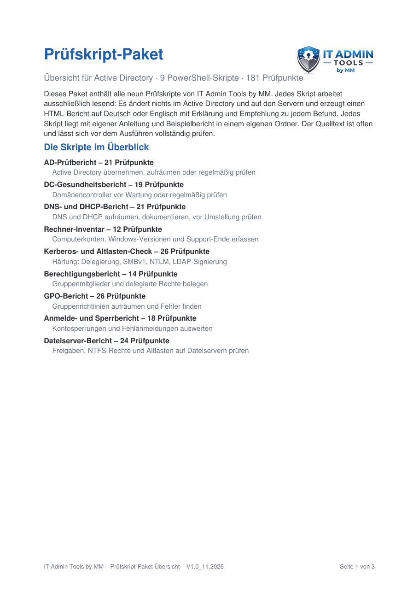
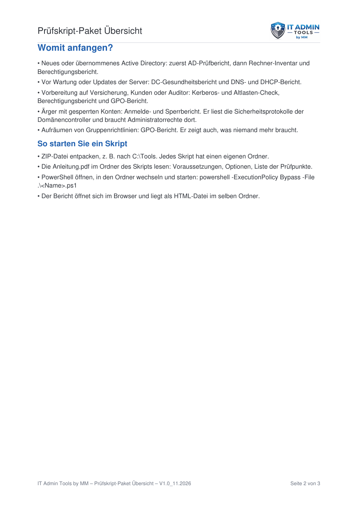
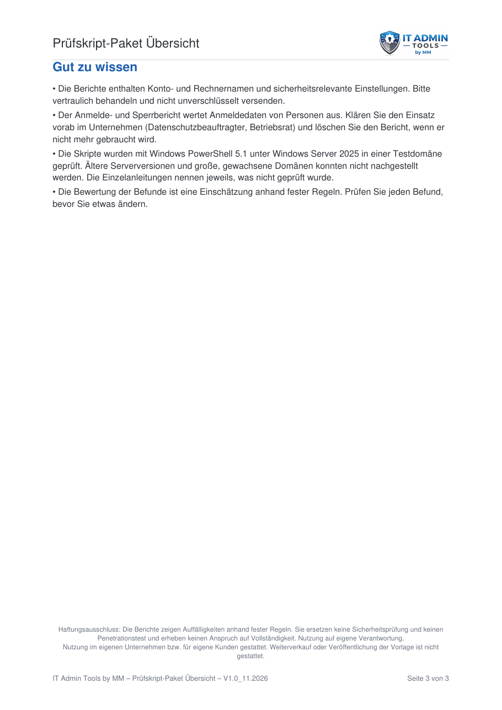

# Prüfskript-Paket – Alle 9 PowerShell-Prüfskripte für Active Directory, Domänencontroller und Dateiserver

Alle neun PowerShell-Prüfskripte für Active Directory, Domänencontroller und Dateiserver im Paket – zusammen 181 Prüfpunkte mit deutschem HTML-Bericht, Erklärung und Empfehlung zu jedem Befund. Die Skripte arbeiten ausschließlich lesend. Einzeln kosten sie zusammen 170,10 €.

**Dieses Verzeichnis enthält kein Skript, nur Bilder der Funktionen.** Die Vollversion gibt es hier:

➜ **[Vollversion auf Gumroad](https://mueller86.gumroad.com/l/awzjtc)** · **[Vollversion auf Etsy](https://www.etsy.com/listing/4611942401)** · **[alle Skripte im Shop](https://www.etsy.com/shop/ITAdminToolsbyMM)**

Alle Bilder stammen aus einer Testumgebung mit erfundenen Daten.

## Übersicht, Seite 1

Aus der Übersicht im Paket: womit anfangen, wie starten, worauf achten.

## Übersicht, Seite 2

Aus der Übersicht im Paket: womit anfangen, wie starten, worauf achten.

## Übersicht, Seite 3

Aus der Übersicht im Paket: womit anfangen, wie starten, worauf achten.

## Eckdaten

- 9 PowerShell-Prüfskripte mit Anleitungen und Beispielberichten, Bericht auf Deutsch oder Englisch (`-Language de|en`)

<!-- querverweis:anfang -->
## Alle Skripte und Vorlagen

Übersicht aller Prüfskripte und Vorlagen: **[github.com/jackyno7](https://github.com/jackyno7)**

Vollversionen:

- Active Directory Prüfbericht: [Etsy](https://www.etsy.com/listing/4588853943) · [Gumroad](https://mueller86.gumroad.com/l/fcneoc)
- Domänencontroller-Gesundheitsbericht: [Etsy](https://www.etsy.com/listing/4593087246) · [Gumroad](https://mueller86.gumroad.com/l/bseljr)
- DNS- und DHCP-Bericht: [Etsy](https://www.etsy.com/listing/4593096270) · [Gumroad](https://mueller86.gumroad.com/l/sthgh)
- Kerberos- und Altlasten-Check: [Etsy](https://www.etsy.com/listing/4593092377) · [Gumroad](https://mueller86.gumroad.com/l/zptvct)
- Berechtigungsbericht Active Directory: [Etsy](https://www.etsy.com/listing/4593113568) · [Gumroad](https://mueller86.gumroad.com/l/xyjmdr)
- GPO-Bericht: [Etsy](https://www.etsy.com/listing/4593129111) · [Gumroad](https://mueller86.gumroad.com/l/wdosl)
- Anmelde- und Sperrbericht: [Etsy](https://www.etsy.com/listing/4593157082) · [Gumroad](https://mueller86.gumroad.com/l/ztktaaq)
- Rechner-Inventar aus Active Directory: [Etsy](https://www.etsy.com/listing/4593088535) · [Gumroad](https://mueller86.gumroad.com/l/zzycdd)
- Dateiserver-Bericht: [Etsy](https://www.etsy.com/listing/4612420692) · [Gumroad](https://mueller86.gumroad.com/l/wbbwj)
- Dateiserver-Rechte-Bericht: [Etsy](https://www.etsy.com/listing/4616706194) · [Gumroad](https://mueller86.gumroad.com/l/ijrkb)
- Windows-Rechnerbericht: [Etsy](https://www.etsy.com/listing/4616020701) · [Gumroad](https://mueller86.gumroad.com/l/wmhfk)
- Exchange-Postfachbericht: [Etsy](https://www.etsy.com/listing/4614916333) · [Gumroad](https://mueller86.gumroad.com/l/gkdllj)
- Exchange-Kalenderrechte-Bericht: [Etsy](https://www.etsy.com/listing/4614799790) · [Gumroad](https://mueller86.gumroad.com/l/iabfb)
- Exchange-Nachrichtenverfolgung: [Etsy](https://www.etsy.com/listing/4614785975) · [Gumroad](https://mueller86.gumroad.com/l/msria)
- Active Directory Prüfskript-Paket: [Etsy](https://www.etsy.com/listing/4611942401) · [Gumroad](https://mueller86.gumroad.com/l/awzjtc)

Kostenlose Skripte: [Zertifikate-Bericht](https://github.com/jackyno7/zertifikate-bericht) ([Gumroad](https://mueller86.gumroad.com/l/zsfvec)) · [Privilegierte-Konten-Check](https://github.com/jackyno7/privilegierte-konten-check) ([Gumroad](https://mueller86.gumroad.com/l/pamjky))

Vorlagen und Checklisten (Notfallplan, Backup, Passwortrichtlinie, Onboarding, Homeoffice, Netzwerk-Dokumentation): [Etsy](https://www.etsy.com/shop/ITAdminToolsbyMM) · [Gumroad](https://mueller86.gumroad.com)
<!-- querverweis:ende -->

## Hinweise

- Bei der Ausarbeitung wurden KI-Werkzeuge unterstützend eingesetzt; Inhalte und Skripte wurden fachlich geprüft und im Testlab getestet.
- Nutzung auf eigene Verantwortung.

---

### English

All nine PowerShell check scripts for Active Directory, domain controllers, and file servers in one package – 181 checks in total, with a German HTML report, explanation, and recommendation for each finding. The scripts operate exclusively in read-only mode. Individually, they cost €170.10 in total. This repository contains screenshots only. Full version: https://mueller86.gumroad.com/l/awzjtc

<!-- querverweis-en:anfang -->
#### All scripts and templates

Overview of all check scripts and templates: **[github.com/jackyno7](https://github.com/jackyno7)**

Full versions:

- Active Directory Audit Report: [Etsy](https://www.etsy.com/listing/4588853943) · [Gumroad](https://mueller86.gumroad.com/l/fcneoc)
- Domain Controller Health Report: [Etsy](https://www.etsy.com/listing/4593087246) · [Gumroad](https://mueller86.gumroad.com/l/bseljr)
- DNS and DHCP Report: [Etsy](https://www.etsy.com/listing/4593096270) · [Gumroad](https://mueller86.gumroad.com/l/sthgh)
- Kerberos and Legacy Check: [Etsy](https://www.etsy.com/listing/4593092377) · [Gumroad](https://mueller86.gumroad.com/l/zptvct)
- Active Directory Permissions Report: [Etsy](https://www.etsy.com/listing/4593113568) · [Gumroad](https://mueller86.gumroad.com/l/xyjmdr)
- GPO Report: [Etsy](https://www.etsy.com/listing/4593129111) · [Gumroad](https://mueller86.gumroad.com/l/wdosl)
- Logon and Lockout Report: [Etsy](https://www.etsy.com/listing/4593157082) · [Gumroad](https://mueller86.gumroad.com/l/ztktaaq)
- Computer Inventory from Active Directory: [Etsy](https://www.etsy.com/listing/4593088535) · [Gumroad](https://mueller86.gumroad.com/l/zzycdd)
- File Server Report: [Etsy](https://www.etsy.com/listing/4612420692) · [Gumroad](https://mueller86.gumroad.com/l/wbbwj)
- File Server Permissions Report: [Etsy](https://www.etsy.com/listing/4616706194) · [Gumroad](https://mueller86.gumroad.com/l/ijrkb)
- Windows Computer Report: [Etsy](https://www.etsy.com/listing/4616020701) · [Gumroad](https://mueller86.gumroad.com/l/wmhfk)
- Exchange Mailbox Report: [Etsy](https://www.etsy.com/listing/4614916333) · [Gumroad](https://mueller86.gumroad.com/l/gkdllj)
- Exchange Calendar Permissions Report: [Etsy](https://www.etsy.com/listing/4614799790) · [Gumroad](https://mueller86.gumroad.com/l/iabfb)
- Exchange Message Tracking: [Etsy](https://www.etsy.com/listing/4614785975) · [Gumroad](https://mueller86.gumroad.com/l/msria)
- Active Directory Check Script Bundle: [Etsy](https://www.etsy.com/listing/4611942401) · [Gumroad](https://mueller86.gumroad.com/l/awzjtc)

Free scripts: [Zertifikate-Bericht](https://github.com/jackyno7/zertifikate-bericht) ([Gumroad](https://mueller86.gumroad.com/l/zsfvec)) · [Privilegierte-Konten-Check](https://github.com/jackyno7/privilegierte-konten-check) ([Gumroad](https://mueller86.gumroad.com/l/pamjky))

Templates and checklists (emergency plan, backup, password policy, onboarding, home office, network documentation): [Etsy](https://www.etsy.com/shop/ITAdminToolsbyMM) · [Gumroad](https://mueller86.gumroad.com)
<!-- querverweis-en:ende -->
